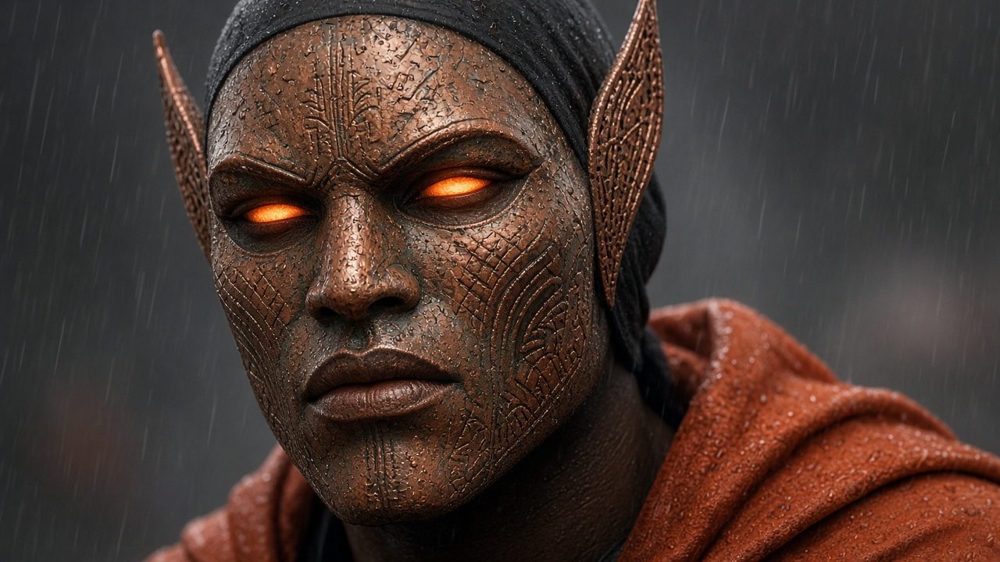
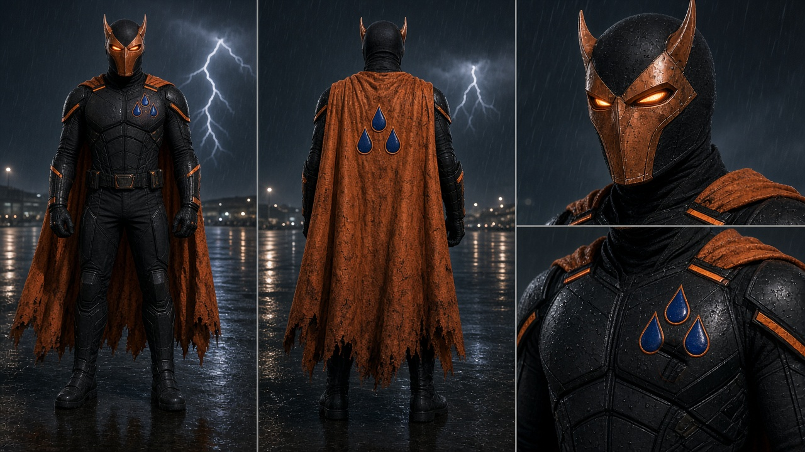

# The ancestral copper mask and Elias's lost tribe

**Status:** CANON (Ceril, 17 Oct 2026)
**Applies to:** Books 1–4 direction and Elias's future hero look

## What it is

The copper mask Elias wears is not something he made or found. It has been **handed down from generation to generation** in his bloodline.

The mask's face is **how his lost tribe looks when the masks are on.** When Elias puts it on, he wears his ancestors' face, not a hero's face.

## The mask's look (locked reference: `assets/mask/elias-ancestral-copper-mask.jpg`)

- Aged, hammered copper with patina, scratches and tool marks. It looks like a real, very old object, not new armor.
- The style is a traditional West African carved mask.
- The face is clearly a strong man's face, calm and stern: a firm brow, a broad nose, a solid square jaw and full, firm lips. It is not brutish and not feminine.
- Carved scarification lines run across the forehead and cheeks.
- The eye slits are almond-shaped and glow orange.
- Two tall, pointed, carved copper ear fins rise from the sides of the head.
- It is a face mask only. A snug black cowl covers the top and back of the head. There is **no helmet** and no hood over the head.

**Rejected directions (don't bring back):** a smooth Iron Man–style faceplate, a full helmet, a lion mask, a dragon mask, an over-heavy brutish face, and a soft or feminine face.

## The suit around it (future look)

- Black armored bodysuit with orange hi-vis bands.
- Weathered orange cape, with the hood **down**.
- **Three** raindrops on the left chest and **three** on the back of the cape.
- Minimal and blue-collar. Not Superman. No aura or glow effects.
- The face on the suit sheet is a placeholder. The ancestral mask above replaces it.

In the story, Elias stays shabby and mechanic-like for now. The suit and mask are his future look.

## Open (not locked yet)

- The tribe's name, where they came from, and how they were lost.
- How the mask reaches Elias, and who held it before him.
- Whether other members of the bloodline (Mother, Sister, RJ) are connected to the mask.
